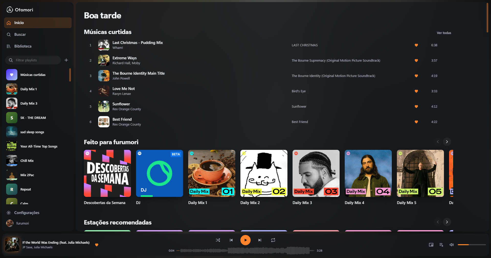
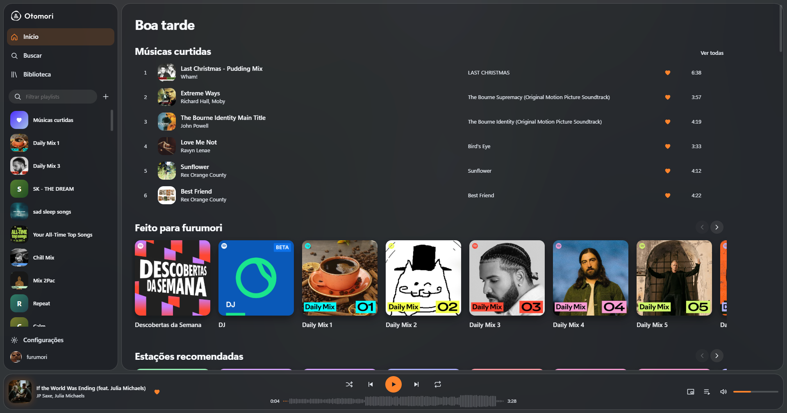
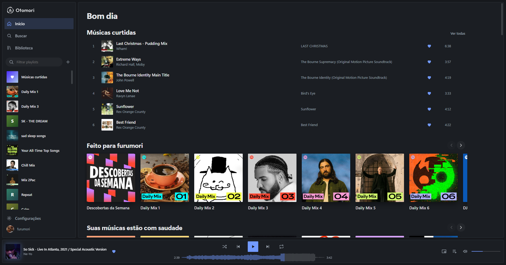
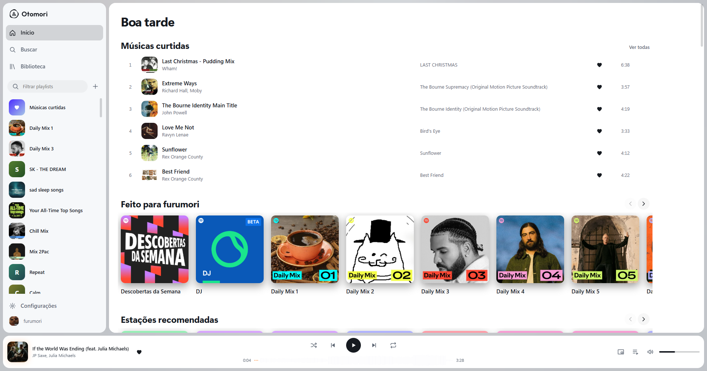

<div align="center">
  <picture>
    <source media="(prefers-color-scheme: dark)" srcset="assets/brand/otomori-assinatura-clara.svg">
    
  </picture>

  <p><strong>All of the sound. None of the weight.</strong></p>
  <p>A light Spotify player for Windows, made your way —<br>built to play your music while you game.</p>

  <p>
    <a href="https://github.com/SeitiFurumori/otomori/releases"></a>
    <a href="https://github.com/SeitiFurumori/otomori/actions/workflows/ci.yml"></a>
    <a href="LICENSE"></a>
    
  </p>

  <p><a href="README.pt-BR.md">🇧🇷 Leia em português</a></p>
</div>

<div align="center">
  
</div>

> [!IMPORTANT]
> **Morune is now Otomori.** 2.0 is the same app with a new name and a new
> interface. If you have Morune 1.0, the update arrives as usual: the installer
> takes its place, and your settings, themes and login come along.
>
> Playback requires a Spotify Premium account.

## Why another Spotify player?

The official app sits open using hundreds of megabytes, wakes the GPU to
animate things nobody is looking at, and stutters when you switch back to it
mid-game.

Otomori has a single rule: **while you play, it must not get in the way.** No
stolen frames, no waking the GPU, no frozen window when you come back to it.
When a game or video goes fullscreen, every animation stops on its own. The
measurements, including what has **not** been measured yet, are in
[PERFORMANCE.md](docs/PERFORMANCE.md).

The name joins 音 (*oto*, sound) and 森 (*mori*, forest).

## What it has

- **Light** — an installer of about 3 MB. The interface runs on the WebView2
  that ships with Windows; the audio engine is Rust.
- **Built for the background** — closes to the tray and keeps playing, with a
  tray menu, a mini player, taskbar thumbnail buttons and media keys.
- **Your way** — four built-in themes and a free-form mode: colors, shape,
  font, and an image, GIF or video background. Whatever you build becomes a
  theme of your own, to keep and share.
- **Color from the music** — in Lume the window takes the color of the album
  art that is playing.
- **Your Spotify, not a copy** — playlists, likes and queue are your account's.
  Reordering one of your playlists changes it on Spotify too.
- **Picks up where you left off** — on launch, your last song is there, paused,
  at the same spot.
- **Safe** — themes are data, never code. Your login lives in the Windows
  Credential Manager, never in a file.

## Themes

| Lume — color from the art | Vidro — Windows acrylic glass |
|---|---|
|  |  |

| Grade — precise and cool | Claro — cool paper, soft shadows |
|---|---|
|  |  |

## Install

Download `Otomori-<version>-setup.exe` from
[Releases](https://github.com/SeitiFurumori/otomori/releases) and run it. No
administrator prompt, and you pick the drive.

Requirements: 64-bit Windows 10 or 11 with WebView2 (included in Windows 11,
delivered to Windows 10 through Edge updates).

The installer is not code-signed yet, so SmartScreen may show "Unknown
publisher". To check the download, compare this against the `.sha256`
published in the same release:

```powershell
Get-FileHash .\Otomori-2.0.0-setup.exe -Algorithm SHA256
```

Details in [installation, security and signing](docs/SIGNING.md).

### First run

1. Open Otomori.
2. Click **Entrar no Spotify** (sign in to Spotify — the interface is in
   Brazilian Portuguese for now).
3. Approve in your browser.
4. Pick a song and play.

Otomori never sees your password: Spotify confirms the sign-in in the browser,
and the app keeps only the access key, in the Windows credential vault.

## Build from source

Requirements: Windows, Node 20+, Rust 1.92+ and MinGW-w64 on `PATH`
(`dlltool` and `as`).

```powershell
. .\tools\env.ps1
cd crates\morune-desktop\ui; npm ci; npm run build; cd ..\..\..
cargo build --release -p morune-desktop
cargo test --workspace
```

The executable lands in `target\release\otomori.exe`. To build the installer:

```powershell
.\tools\build-installer.ps1 -Version 2.0.0
```

Read the [contributing guide](CONTRIBUTING.md) first. Architecture, decisions
and the release process are indexed in [docs/](docs/README.md).

## License and trademarks

Otomori is released under the [MIT license](LICENSE). Third-party notices are
in [THIRD-PARTY-LICENSES.txt](THIRD-PARTY-LICENSES.txt).

Otomori is not affiliated with, associated with or endorsed by Spotify.
Streaming uses [librespot](https://github.com/librespot-org/librespot) and
requires Premium. Spotify is a trademark of Spotify AB.
