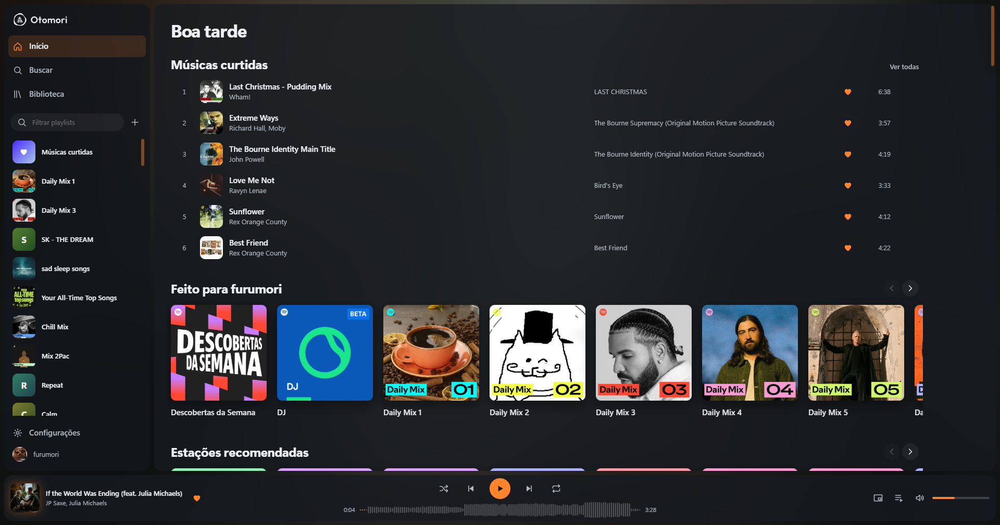
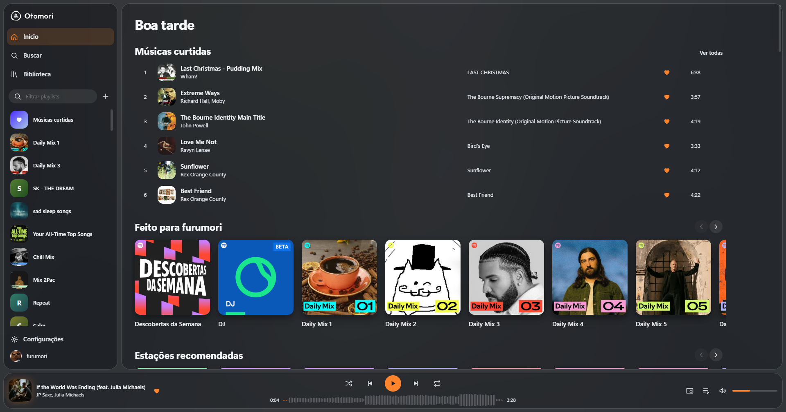
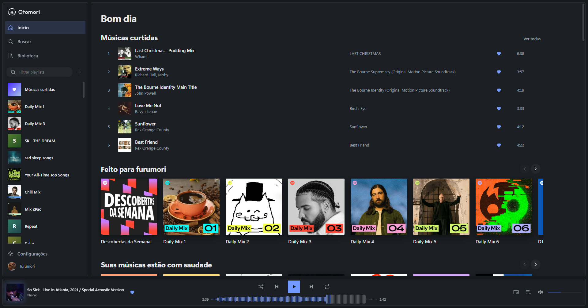
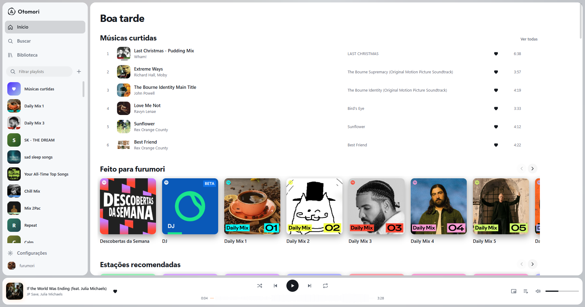

<div align="center">
  <picture>
    <source media="(prefers-color-scheme: dark)" srcset="assets/brand/otomori-assinatura-clara.svg">
    
  </picture>

  <p>Player de Spotify para Windows, leve e do seu jeito —<br>feito para tocar a sua música enquanto você joga.</p>

  <p>
    <a href="https://github.com/SeitiFurumori/otomori/releases"></a>
    <a href="https://github.com/SeitiFurumori/otomori/actions/workflows/ci.yml"></a>
    <a href="LICENSE"></a>
    
  </p>

  <p><a href="README.md">🇬🇧 Read in English</a></p>
</div>

<div align="center">
  
</div>

> [!IMPORTANT]
> **O Morune agora se chama Otomori.** A 2.0 é o mesmo app, com nome e tela
> novos. Quem tem o Morune 1.0 recebe a atualização normalmente: o instalador
> entra no lugar dele, e suas configurações, temas e login vêm junto.
>
> A reprodução exige uma conta Spotify Premium.

## Por que mais um player de Spotify?

O app oficial fica aberto pesando centenas de megabytes, acorda a placa de
vídeo para animar o que ninguém está olhando e engasga quando você volta para
ele no meio de um jogo.

O Otomori tem um critério só: **enquanto você joga, ele não pode atrapalhar.**
Nada de roubar quadro, acordar a placa de vídeo ou travar a janela quando você
volta para ela. Quando um jogo ou vídeo ocupa a tela cheia, toda animação para
sozinha. As medições, inclusive o que **ainda não** foi medido, estão em
[PERFORMANCE.md](docs/PERFORMANCE.md).

O nome junta 音 (*oto*, som) e 森 (*mori*, floresta). A frase diz o resto:
**o som fica, o peso não.**

## O que ele tem

- **Leve** — instalador de uns 3 MB. A tela usa o WebView2 que já vem no
  Windows, e o motor de áudio é em Rust.
- **Feito para o segundo plano** — fecha para a bandeja e segue tocando, com
  menu na bandeja, mini player, botões na miniatura da barra de tarefas e
  teclas de mídia.
- **Do seu jeito** — quatro temas prontos e um modo liberdade total: cores,
  forma, fonte e fundo com imagem, GIF ou vídeo. O que você montar vira um tema
  seu, para guardar e compartilhar.
- **Cor que vem da música** — no tema Lume a janela pega a cor da capa que está
  tocando.
- **O seu Spotify, não uma cópia** — playlists, curtidas e fila são da sua
  conta. Reordenar uma playlist sua muda no Spotify também.
- **Volta de onde parou** — ao abrir, a última música está lá, pausada, no
  mesmo ponto.
- **Seguro** — temas são dados, nunca código. O login fica no Gerenciador de
  Credenciais do Windows, nunca num arquivo.

## Temas

| Lume — a cor vem da capa | Vidro — o acrílico do Windows |
|---|---|
|  |  |

| Grade — preciso e frio | Claro — papel frio, sombras macias |
|---|---|
|  |  |

## Instalar

Baixe `Otomori-<versão>-setup.exe` em
[Releases](https://github.com/SeitiFurumori/otomori/releases) e execute. Não
pede permissão de administrador, e você escolhe o disco.

Requisitos: Windows 10 ou 11 de 64 bits, com o WebView2 (já vem no Windows 11
e chega ao 10 pelas atualizações do Edge).

O instalador ainda não tem assinatura digital, então o SmartScreen pode
mostrar "Editor desconhecido". Para conferir o download, compare o resultado
abaixo com o `.sha256` publicado na mesma release:

```powershell
Get-FileHash .\Otomori-2.0.0-setup.exe -Algorithm SHA256
```

Detalhes em [instalação, segurança e assinatura](docs/SIGNING.md).

### Primeiro uso

1. Abra o Otomori.
2. Clique em **Entrar no Spotify**.
3. Autorize no navegador.
4. Escolha uma música e toque.

O Otomori nunca vê a sua senha: o Spotify confirma a entrada no navegador, e o
app guarda só a chave de acesso, no cofre do Windows.

## Compilar do código

Requisitos: Windows, Node 20+, Rust 1.92+ e MinGW-w64 no `PATH` (`dlltool`
e `as`).

```powershell
. .\tools\env.ps1
cd crates\morune-desktop\ui; npm ci; npm run build; cd ..\..\..
cargo build --release -p morune-desktop
cargo test --workspace
```

O executável sai em `target\release\otomori.exe`. Para gerar o instalador:

```powershell
.\tools\build-installer.ps1 -Version 2.0.0
```

Leia antes o [guia de contribuição](CONTRIBUTING.md). Arquitetura, decisões e
processo de publicação estão em [docs/](docs/README.md).

## Licença e marcas

O Otomori é distribuído sob a [licença MIT](LICENSE). Avisos de terceiros estão
em [THIRD-PARTY-LICENSES.txt](THIRD-PARTY-LICENSES.txt).

O Otomori não é afiliado, associado nem endossado pelo Spotify. O streaming usa
[librespot](https://github.com/librespot-org/librespot) e exige conta Premium.
Spotify é marca da Spotify AB.
